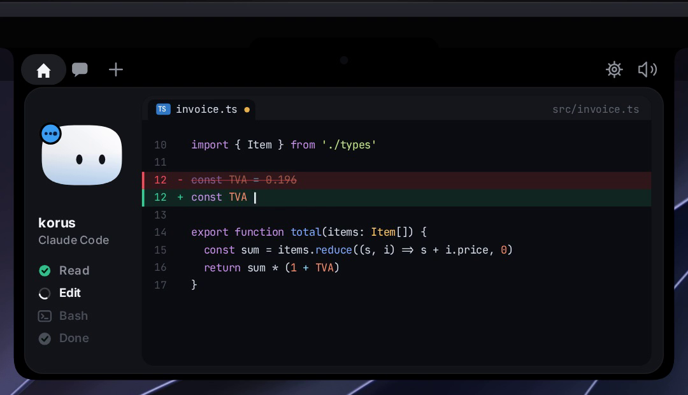
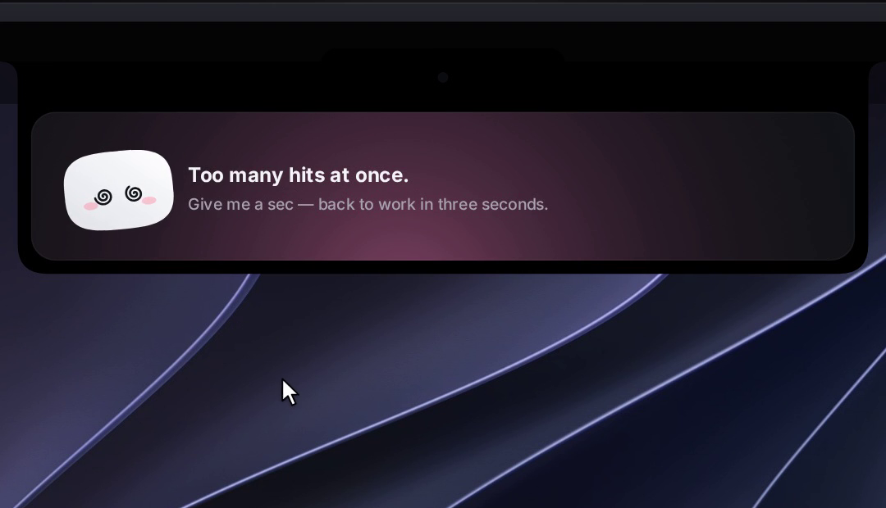

# CleoNotch

<div align="center">


**An intelligent on-screen companion that lives in your Mac's notch — or at the top of your screen on Windows and Linux — keeping an eye on your AI coding agent sessions.**

[](NotchBuddy/)
[](windows/)
[](windows/)
[](NotchBuddy/)
[](NotchBuddy/)
[](windows/)
[](LICENSE)


</div>

---

## Overview

**CleoNotch** is an open-source, local-first dynamic notch companion designed to seamlessly monitor autonomous AI coding agents (Claude Code, Cursor, Codex, Gemini CLI, Antigravity) directly from your screen bezel. 

Approve permissions with a single click, track real-time file reads/edits/terminal execution, drop files directly into active agent context, and communicate with LLMs — all without interrupting your workflow.

---

## Key Features

- 🤖 **Live Agent Session Monitoring**: Real-time status for Claude Code, Cursor, Codex, Gemini CLI, and Antigravity. Tag hook payloads with `coucou_agent` to grant any agent its own dedicated status pill.
- ✅ **One-Click Notch Approvals**: Permission prompts from Claude Code and Codex surface directly in your notch with instant **Allow / Deny / Always** buttons.
- 🧑‍💻 **Terminal Window Switching**: Immediately focus and jump to the specific terminal window running an active session (*macOS*).
- 💬 **Integrated Model Chat**: Chat with Claude, Gemini, or OpenAI models directly using your personal BYOK API keys stored securely in OS credential stores.
- 📎 **Context Drag & Drop**: Drag documents, source code, or images onto the notch to attach them to your active AI prompt session.
- 🪟 **Window Context Attachment**: Drag the companion onto any active window to automatically capture and append its context (*macOS*).
- 🔌 **Ecosystem Integrations**: Real-time status indicators for GitHub, Vercel deployments, Stripe transactions, n8n workflows, Resend emails, Notion, and Cal.com.
- 🎭 **Organic Micro-Interactions**: Smooth 60 FPS procedural animations, interactive eye tracking following cursor movement, reactive states, and 28 spatial sound effects.
- 🫥 **Zero-Footprint Idle**: Completely recedes into the display notch or top bezel when idle, expanding gracefully on hover or upon incoming agent events.
- 🔒 **BYOK Privacy Invariant**: Zero telemetry and zero third-party accounts. All secret keys are strictly stored in macOS Keychain, Windows Credential Manager, or Linux Secret Service.

---

## Visual Showcase

<table>
<tr>
<td width="50%"></td>
<td width="50%"></td>
</tr>
<tr>
<td width="50%"></td>
<td width="50%"></td>
</tr>
</table>

---

## System Architecture

CleoNotch is engineered with a dual-engine architecture optimized for native platform performance:

```
┌─────────────────────────────────────────────────────────────┐
│                       CleoNotch Runtime                     │
├──────────────────────────────┬──────────────────────────────┤
│      macOS Native Engine     │   Windows & Linux Engine     │
│   • Swift 6 + SwiftUI        │   • Tauri v2 + Rust Core     │
│   • NSPanel Notch Anchoring  │   • Transparent Layer Shell  │
│   • CoreAnimation Timeline   │   • Canvas 2D Procedural VFX │
│   • Unix Domain Sockets      │   • Win32 Named Pipes / IPC  │
└──────────────┬───────────────┴──────────────┬───────────────┘
               │                              │
┌──────────────▼──────────────────────────────▼───────────────┐
│                    Agent Hook Protocols                     │
│    Claude Code • Cursor • Codex • Gemini CLI • Antigravity  │
└─────────────────────────────────────────────────────────────┘
```

---

## Installation & Setup

### macOS Installation

1. Download the latest release from the [Releases](https://github.com/delightc123/CleoNotch/releases) section.
2. Unpack `CleoNotch.zip` and move `CleoNotch.app` to your `/Applications` directory.
3. Launch the application and grant accessibility permissions when prompted.

### Windows & Linux (Tauri Engine)

On Windows and Linux displays lacking a physical camera notch, CleoNotch docks unobtrusively along the top border of your screen:
- **Windows**: Install the `.exe` installer or build from source via `windows/`.
- **Linux**: Available as AppImage, `.deb`, and `.rpm` packages supporting Wayland compositors (COSMIC, KDE Plasma, Hyprland, Sway) and X11.

---

## Building from Source

### macOS (Swift 6 & Xcode)

**Prerequisites**: macOS 15+, Xcode 16+, [XcodeGen](https://github.com/yonaskolb/XcodeGen).

```bash
# Clone the repository
git clone https://github.com/delightc123/CleoNotch.git
cd CleoNotch/NotchBuddy

# Generate the Xcode project and build
xcodegen
open NotchBuddy.xcodeproj   # Press ⌘R to run
```

### Windows (Tauri v2 & Rust)

**Prerequisites**: [Rust toolchain](https://rustup.rs), Node.js 20+, MSVC build tools.

```powershell
git clone https://github.com/delightc123/CleoNotch.git
cd CleoNotch/windows
npm install
npm run pack                # Output artifact generated in windows/release/
```

### Linux (WebKitGTK & GTK Layer Shell)

**Prerequisites**: Rust, Node.js 20+, GTK Layer Shell, and WebKit2GTK libraries.

```bash
sudo apt update && sudo apt install -y build-essential pkg-config \
  libwebkit2gtk-4.1-dev libgtk-layer-shell-dev libayatana-appindicator3-dev \
  librsvg2-dev libssl-dev libdbus-1-dev patchelf \
  gstreamer1.0-plugins-base gstreamer1.0-plugins-good

git clone https://github.com/delightc123/CleoNotch.git
cd CleoNotch/windows
npm install
npm run pack
```

---

## Configuration & Agent Hooks

Open Settings via the menu bar icon (macOS) or system tray (Windows/Linux) to configure your environment:

| Integration | Functionality | Storage & Verification |
| :--- | :--- | :--- |
| **Claude Code Hooks** | Real-time session monitoring & approval gates | Merges into `~/.claude/settings.json` with automatic backup |
| **Gemini CLI Hooks** | Live Gemini CLI step-by-step telemetry | Configures `~/.gemini/settings.json` |
| **Antigravity Hooks** | Agentic workflows and hook dispatching | Configures `~/.gemini/config/hooks.json` |
| **Anthropic / OpenAI / Gemini** | Direct model chat & contextual file analysis | Stored locally in OS Keychain / Credential Manager |
| **Services (GitHub, Stripe, etc.)** | Ambient webhook monitoring pills | Secure local storage; active only when enabled |

> **Fail-Safe Guarantee**: If CleoNotch is not running, hook relays exit immediately without blocking Claude Code or any connected terminal sessions.

---

## Contributing

Contributions are welcomed! Feel free to submit pull requests for new agent integrations, UI themes, or performance enhancements. Please review [CONTRIBUTING.md](CONTRIBUTING.md) for contribution guidelines.

---

## License & Attribution

- **Source Code**: [MIT License](LICENSE) — Copyright © 2026 **Delight Chukwu** ([@delightc123](https://github.com/delightc123)).
- **Media & Assets**: See [LICENSE-ASSETS.md](LICENSE-ASSETS.md).
- Developed on top of the open-source Coucou architecture by Louis Raillé.
